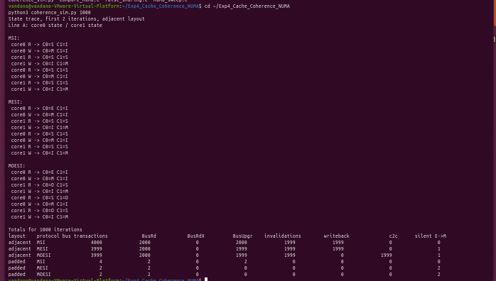
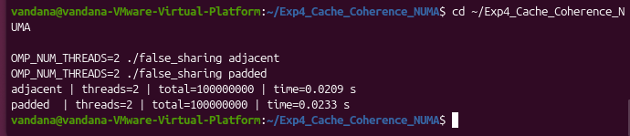
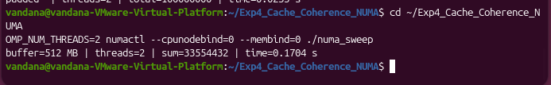
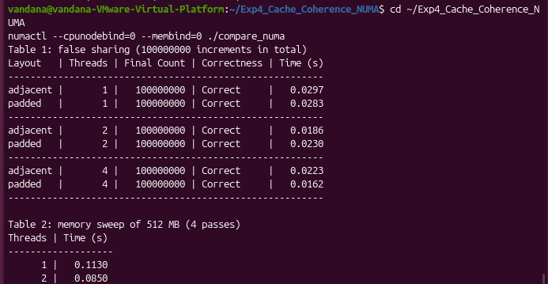
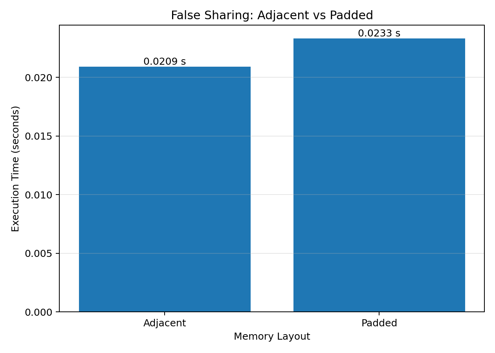
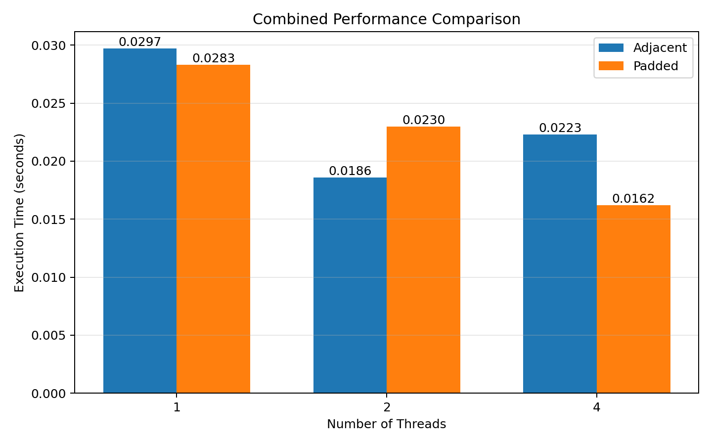
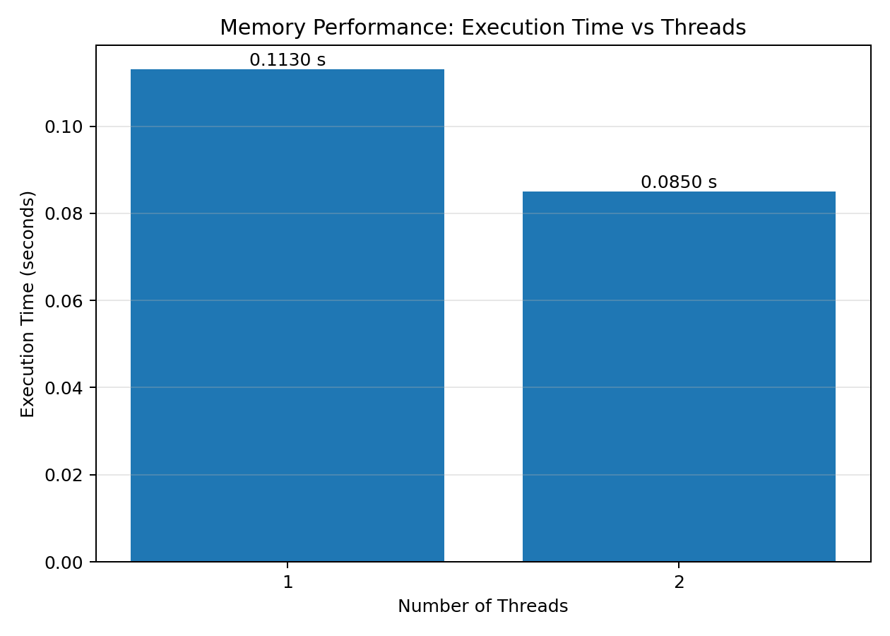

# PGC Experiment 4: Cache Coherence and NUMA Memory Access Performance

## Aim

To analyze cache coherence protocols (MSI, MESI, and MOESI), understand false sharing, and study NUMA memory access performance using C and Python programs.

## Environment

- OS: Ubuntu 26.04.1 LTS
- Processor: Intel Core i5-1235U
- Compiler: GCC 15.2.0
- Python: 3.14.4
- NUMA utility: numactl 2.0.19
- OpenMP: Used for parallel execution

## Experiments

### Experiment 1: Cache Coherence Simulation (MSI, MESI, MOESI)

**File:** `coherence_sim.py`

Simulated the MSI, MESI, and MOESI cache coherence protocols using adjacent and padded memory layouts.

The simulation compares bus transactions, BusRd, BusRdX, BusUpgr, invalidations, writebacks, cache-to-cache transfers, and silent E-to-M transitions.

**Observed results:**

| Layout | Protocol | Bus Transactions | Invalidations | Writebacks |
|---|---|---:|---:|---:|
| Adjacent | MSI | 4000 | 1999 | 1999 |
| Adjacent | MESI | 3999 | 1999 | 1999 |
| Adjacent | MOESI | 3999 | 1999 | 0 |
| Padded | MSI | 4 | 0 | 0 |
| Padded | MESI | 2 | 0 | 0 |
| Padded | MOESI | 2 | 0 | 0 |

The adjacent layout generated significantly more coherence traffic than the padded layout.

**Output:**

### Experiment 2: False Sharing

**File:** `false_sharing.c`

Implemented a parallel counter experiment using adjacent and padded memory layouts to observe the effect of false sharing.

**Observed output:**

| Layout | Threads | Final Count | Time |
|---|---:|---:|---:|
| Adjacent | 2 | 100000000 | 0.0209 s |
| Padded | 2 | 100000000 | 0.0233 s |

Both layouts produced the correct final count. Execution times can vary between runs depending on system conditions.

**Output:**

### Experiment 3: NUMA Memory Sweep

**File:** `numa_sweep.c`

Performed a memory sweep using OpenMP and numactl to study memory access performance with CPU and memory binding.

**Execution configuration:**

- Buffer size: 512 MB
- Threads: 2
- CPU node: 0
- Memory node: 0
- Passes: 4

**Observed output:**

| Buffer | Threads | Sum | Time |
|---|---:|---:|---:|
| 512 MB | 2 | 33554432 | 0.1704 s |

**Output:**

### Experiment 4: Combined NUMA and False Sharing Comparison

**File:** `compare_numa.c`

Compared adjacent and padded memory layouts using different thread counts and measured memory sweep performance.

**Table 1: False Sharing Comparison**

| Layout | Threads | Final Count | Correctness | Time (s) |
|---|---:|---:|---|---:|
| Adjacent | 1 | 100000000 | Correct | 0.0297 |
| Padded | 1 | 100000000 | Correct | 0.0283 |
| Adjacent | 2 | 100000000 | Correct | 0.0186 |
| Padded | 2 | 100000000 | Correct | 0.0230 |
| Adjacent | 4 | 100000000 | Correct | 0.0223 |
| Padded | 4 | 100000000 | Correct | 0.0162 |

**Table 2: Memory Sweep Comparison**

| Threads | Time (s) |
|---:|---:|
| 1 | 0.1130 |
| 2 | 0.0850 |

**Output:**

## NUMA Testing Limitation

The virtual machine exposed only one NUMA node (node 0). Therefore, CPU and memory binding were performed on node 0.

Remote NUMA memory access could not be tested because a second NUMA node was not available in the virtual machine. Multiple virtual machines do not create multiple NUMA nodes.

## Conclusion

- MSI, MESI, and MOESI protocols were simulated and compared.
- The adjacent memory layout generated more cache coherence traffic than the padded layout in the simulation.
- False sharing was studied using adjacent and padded memory layouts.
- NUMA memory sweep performance was measured using CPU and memory binding on node 0.
- The combined experiment compared performance across different thread counts.
- Remote NUMA access requires a system exposing multiple NUMA nodes.

## Repository Files

| File | Description |
|---|---|
| `coherence_sim.py` | Cache coherence protocol simulation |
| `false_sharing.c` | False sharing experiment |
| `numa_sweep.c` | NUMA memory sweep |
| `compare_numa.c` | Combined performance comparison |
| `screenshots/` | Experiment output screenshots |

---

## Author

**Name:** Vandana A M  
**Course:** Parallel and GPU Computing (PGC)  
**Experiment:** 04 – Cache Coherence and NUMA Memory Access Performance

---

## Performance Graphs

### False Sharing: Adjacent vs Padded

### Combined Comparison Across Thread Counts

### Memory Performance vs Threads

